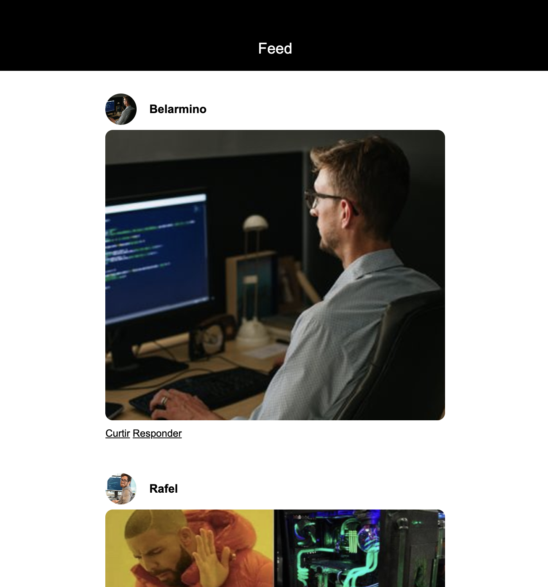

# Social Feed Layout

Uma interface estática de feed social criada para praticar composição de cartões, imagens de perfil e comportamento responsivo com CSS.

## Vídeo de demonstração

[▶ Ver demonstração curta](./docs/media/demo.mp4)

## O que foi construído

- Feed com três publicações e respetivos autores.
- Estrutura semântica com navegação, conteúdo principal e cartões de publicação.
- Layout adaptável a diferentes larguras de ecrã.

## O que aprofundei

- Organização de uma página com elementos semânticos como `nav`, `section` e `article`.
- Composição de cartões com imagens de perfil, conteúdo visual e ações.
- Responsividade e controlo de espaçamentos para manter a leitura confortável em vários ecrãs.

## Tecnologias

  
  

## Como executar

Não requer instalação. Abra o ficheiro `index.html` no navegador.

## Nota

Este é um projeto de prática de front-end; as ações de “Curtir” e “Responder” são apenas visuais.

