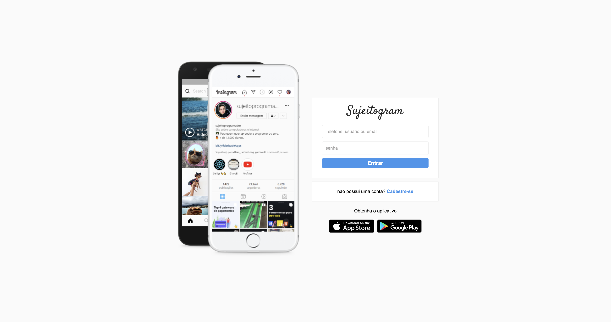

# Instagram Login Clone

Recriação de uma interface de autenticação inspirada no Instagram, desenvolvida para praticar formulários, duas colunas e responsividade.

## Vídeo de demonstração

[▶ Ver demonstração curta](./docs/media/demo.mp4)

## Funcionalidades

- Página de início de sessão.
- Página de criação de conta.
- Layout responsivo com chamadas para as lojas de aplicações.

## Tecnologias

`HTML5` · `CSS3`

## Como executar

Abra `index.html` no navegador. Para aceder diretamente ao registo, abra `signup.html`.

## Nota

É uma interface de estudo: os formulários não enviam credenciais nem ligam a qualquer serviço.

