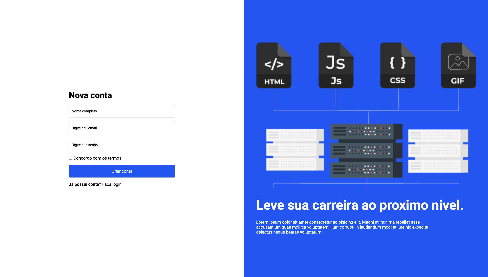

# Responsive Login Page

Interface de autenticação com páginas de início de sessão e registo, pensada para consolidar formulários, layout em duas colunas e responsividade.

## Vídeo de demonstração

[▶ Ver demonstração curta](./docs/media/demo.mp4)

## Funcionalidades

- Página de início de sessão.
- Página de criação de conta.
- Navegação entre os dois fluxos.
- Adaptação para ecrãs pequenos.

## O que aprofundei

- Marcação de formulários de início de sessão e registo com foco em clareza visual.
- Organização de conteúdos em colunas e alinhamento de elementos com CSS.
- Construção de uma interface responsiva para diferentes tamanhos de ecrã.

## Tecnologias

  
  

## Como executar

Abra `signin.html` no navegador. A página de registo está disponível em `signup.html`.

## Nota

Este projeto apresenta apenas a interface; não envia nem armazena dados de utilizadores.

