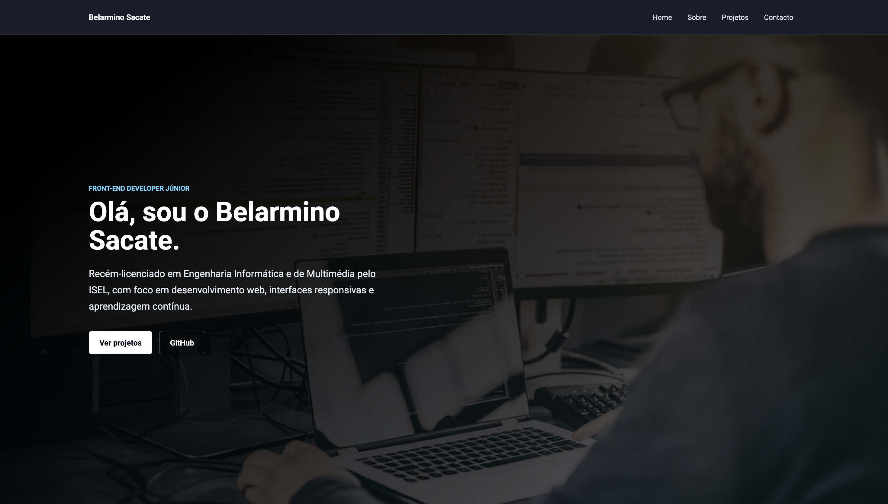

# Portfolio Pessoal

Portfolio responsivo de Belarmino Sacate, criado para apresentar perfil, competências e projetos de front-end.

## Vídeo de demonstração

[▶ Ver demonstração curta](./docs/media/demo.mp4)

## Conteúdo

- Apresentação profissional e resumo de competências.
- Secção de projetos com ligações para os respetivos repositórios.
- Contactos para email, LinkedIn e GitHub.
- Navegação por âncoras e design responsivo.

## Tecnologias

`HTML5` · `CSS3`

## Como executar

Abra `index.html` no navegador. Não requer instalação.

