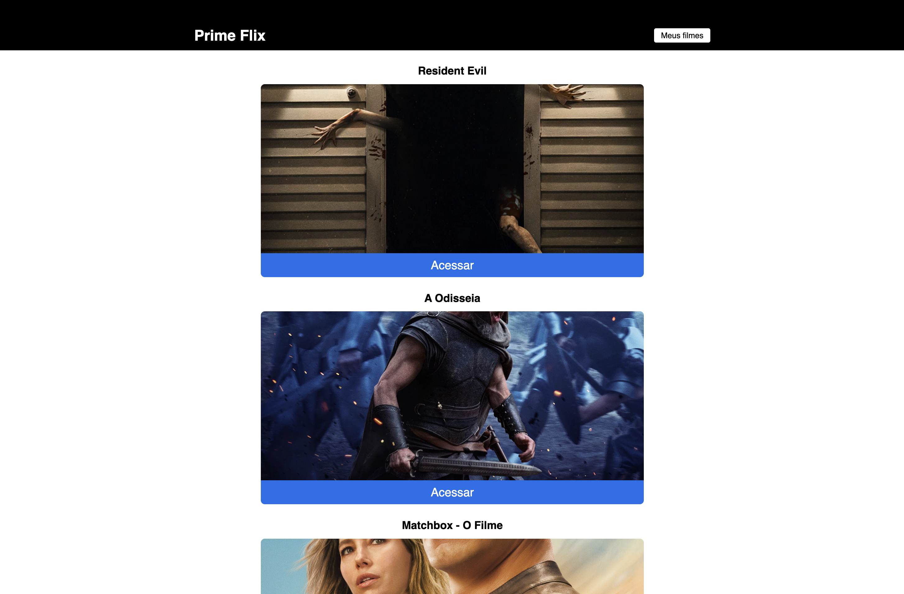

# PrimeFlix

Aplicação React para descobrir filmes em exibição, consultar detalhes e criar uma lista pessoal de favoritos.



## Vídeo de demonstração

[▶ Ver demonstração curta](./docs/media/demo.mp4)

## Funcionalidades

- Lista filmes atualmente em cartaz através da API do TMDB.
- Mostra título, imagem, sinopse e avaliação de cada filme.
- Pesquisa trailers no YouTube.
- Guarda e remove filmes da lista pessoal através de `localStorage`.
- Mostra notificações de sucesso e de itens repetidos.

## Tecnologias

`React` · `Vite` · `React Router` · `Axios` · `React Toastify` · `TMDB API`

## Como executar

```bash
npm install
cp .env.example .env
# Adiciona a tua chave da API do TMDB em VITE_TMDB_API_KEY
npm run dev
```

Para gerar uma chave, cria uma conta no [TMDB](https://www.themoviedb.org/settings/api). O ficheiro `.env` não é versionado.

## Scripts

```bash
npm run dev
npm run build
npm run lint
```
