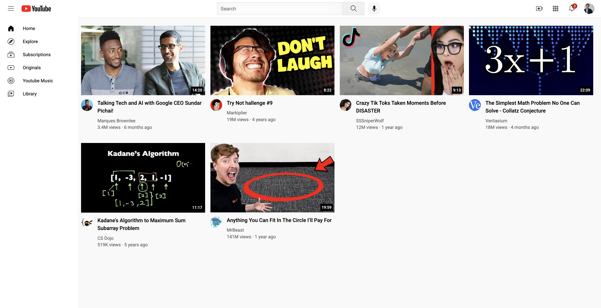

# YouTube Home Clone

Recriação estática da página inicial do YouTube para praticar layouts com CSS Grid, cabeçalho fixo, barra lateral e cartões de vídeo.

## Vídeo de demonstração

[▶ Ver demonstração curta](./docs/media/demo.mp4)

## O que foi construído

- Cabeçalho com pesquisa, ações e notificações.
- Barra lateral de navegação.
- Grelha responsiva de vídeos, thumbnails, duração e cartões de canais.
- Tooltips e detalhes visuais inspirados na interface do YouTube.

## O que aprofundei

- Construção de uma grelha de conteúdo com CSS Grid e alinhamento de elementos com Flexbox.
- Posicionamento de cabeçalho e barra lateral para estruturar uma interface de maior dimensão.
- Organização de estilos por responsabilidade e criação de detalhes de interface, como tooltips e cartões de vídeo.

## Tecnologias

  
  

## Como executar

Abra `youtube.html` no navegador. Não requer dependências.

## Nota

Projeto educativo de recriação visual, sem associação oficial ao YouTube.

