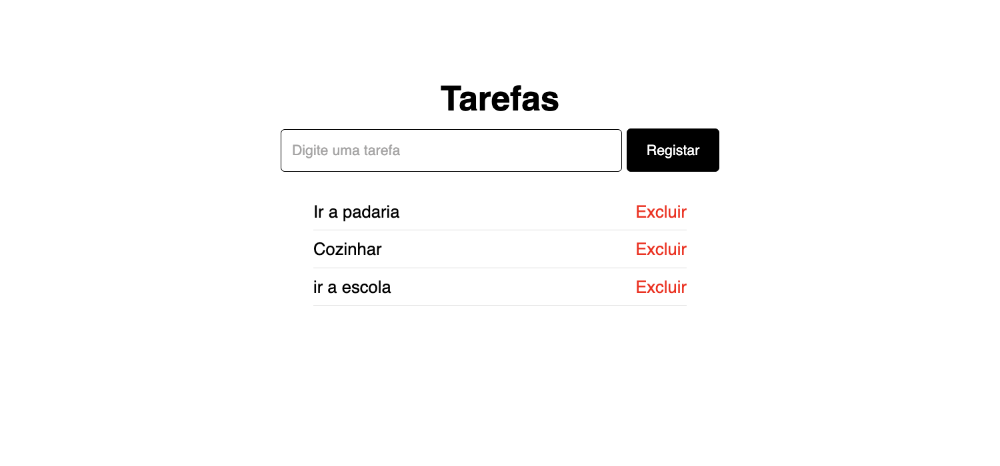
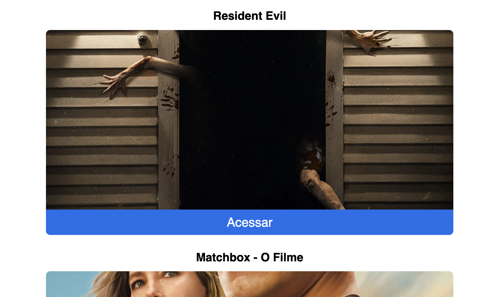

<h1 align="center">FullStackRoad</h1>

  Registo da minha evolução no desenvolvimento web através de exercícios, desafios e projetos práticos realizados ao longo do <strong>FullStack PRO</strong>, da Sujeito Programador.

  <a href="https://sujeitoprogramador.com/fullstackpro/">Conhecer o curso FullStack PRO</a>

---

## Sobre o curso

O [FullStack PRO](https://sujeitoprogramador.com/fullstackpro/) é uma formação prática que parte dos fundamentos da web e evolui para desenvolvimento frontend, backend, aplicações full-stack e ferramentas de IA para desenvolvimento. O percurso combina aulas passo a passo, desafios e projetos completos, desde HTML e CSS até aplicações com React, Next.js, Node.js, bases de dados e pagamentos.

Este repositório reúne o código que desenvolvi durante essa jornada. Funciona simultaneamente como arquivo de estudo, espaço de experimentação e portefólio da minha progressão como **Junior Full-Stack Developer**.

---

## Pontos abordados no FullStack PRO

| Área | Pontos abordados |
| --- | --- |
| **Fundamentos da web** | HTML5, CSS moderno, JavaScript completo, desafios e projetos práticos. |
| **Desenvolvimento web** | React, projetos com React, Firebase, TypeScript, React com TypeScript e plataformas com autenticação e base de dados. |
| **Aplicações profissionais** | Plataforma de venda de carros, testes automatizados com React, Next.js e Next 15, sites e sistemas web profissionais. |
| **SaaS completo** | Desenvolvimento de um SaaS com Next.js e base de dados, login com Google, Stripe, subscrições, deploy e pagamentos em produção. |
| **Desenvolvimento backend** | Node.js, APIs REST, padrões, JWT, Prisma, PostgreSQL, sistema de pizzaria, sistema de barbearia e NestJS com testes automatizados. |
| **IA para developers** | Uso de IA no fluxo de trabalho de engenharia de software, agents, subagents, MCP servers, contexto, rules, prompts e ferramentas de desenvolvimento. |

A estrutura acima acompanha o programa apresentado na [página oficial do curso](https://sujeitoprogramador.com/fullstackpro/).

---

## Tecnologias abordadas

  
  
  
  
  
  
  
  
  
  

---

## Projetos desenvolvidos

### [Portefólio pessoal](https://github.com/belarminooO/portfolio)

### [Interface do Instagram](https://github.com/belarminooO/instagram-login-clone)

### [Layout do YouTube](https://github.com/belarminooO/youtube-home-clone)

### [Página de login responsiva](https://github.com/belarminooO/responsive-login-page)

### [Lista de tarefas](https://github.com/belarminooO/lista-de-tarefas)

### [Feed social](https://github.com/belarminooO/social-feed-layout)

### [PrimeFlix](https://github.com/belarminooO/primeflix)

---

## Conteúdos deste repositório

| Área | Conteúdo |
| --- | --- |
| [HTML](./HTML) | Estrutura semântica, tabelas, formulários, áudio e vídeo. |
| [CSS](./CSS) | Seletores, modelo de caixas, Flexbox, Grid, animações e responsividade. |
| [JavaScript](./JavaScript) | Lógica, funções, arrays, objetos, DOM e eventos. |
| [Desafios](./Desafios) | Exercícios práticos de JavaScript. |
| [ReactJS](./ReactJS) | Estudos e exercícios centrados em React. |
| [Projetos](./Projetos) | Aplicações desenvolvidas ao longo do percurso. |

---

## Contactos

<a href="https://www.linkedin.com/in/belarmino-sacate-1b830037b/">
  
  LinkedIn Profile
</a>
 
 
<a href="mailto:belarmino.s.bs@gmail.com">
  
  belarmino.s.bs@gmail.com
</a>
